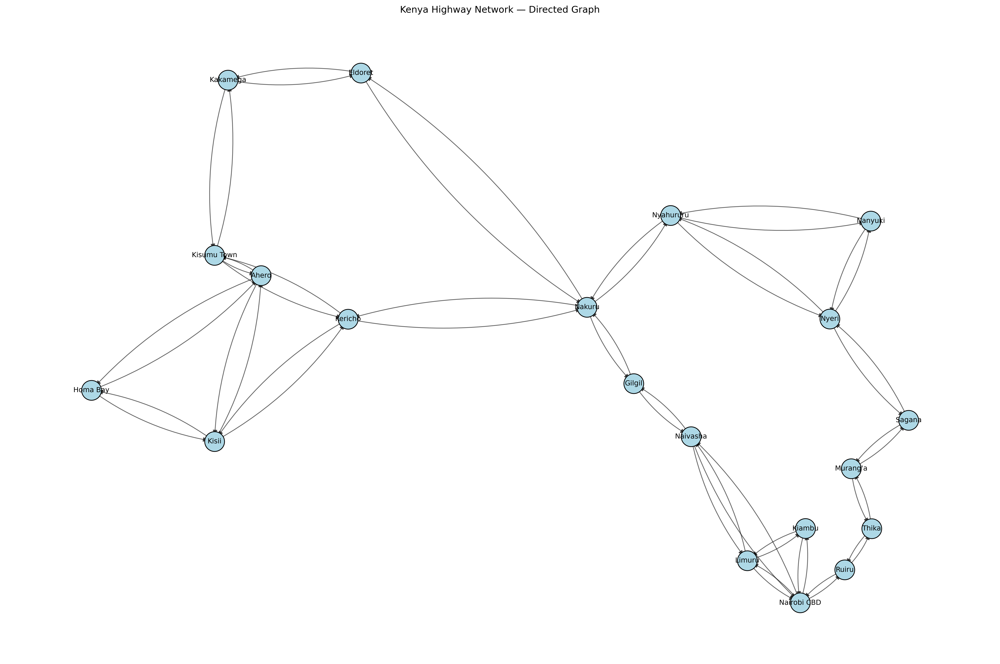
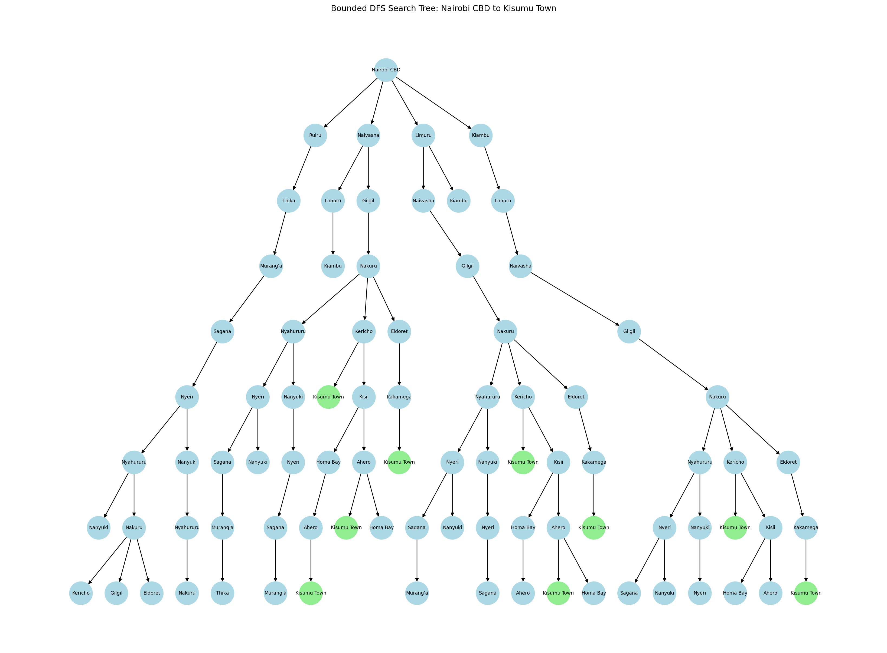

## Designing a Searching Agent

# PEAS Framework of self driving truck
1. Performance Measure - Safety, fuel efficiency, time optimization, successful follow of the traffic laws, minimal damage to the goods it carries and delivery of cargo on time.

2. Environment - Kenyan highways connecting Nairobi, Central , Rift valley and lake Victoria, wildlife, human drivers , changing road conditions, pedestrians, traffic lights, traffic signs and road surfaces.

3. Actuators(components the agent uses to take action) -  Steering system, accelerator, break system, indicators, horn, light, gear control

4. Sensors(Components the agent uses to take information from the environment)- Cameras, GPS system, speed sensor, weight and load system

## Defining the environmet
1. Fully observable vs Partially observable
- The environment for this agent is partially observable
- Because the agent cannot observe everything in its environment something like in a sharp may hide a pedestrian or a car also a road hazard maybe outside the sensors view

2. Deterministic vs Stochastic
- Classification - Stochastic
- Because the outcome is not always predictable even if the agent follows a specified route unexpected accident may make the journey longer or unexpected weather may halt the journey abit. So there are things that the agent can't control

3. Episodic vs Sequential
- classification - sequential
- Because the each decision by the agent affects future decisions like choosing one path decides the next town you will arrive at.

4. static vs dynamic
- Classification - Dynamic
- Because the environment changes while the truck is operating. Other vehicle move, obstacles may appear so the environment is dynamic

5. Single agent vs Multi agent
- Classification - Multi agent
- Because the agent is operating with other agents in the road like human drivers, pedesrtians and other self driving car. So the agent is not operating on its own hence its a multi agent

## Building the Graph and Search Tree

### How we built the graph

We selected 20 towns across Nairobi, the Central Highlands, the Rift Valley, and the Lake Victoria Basin. We represented each town as a node, and used arrows to show possible journeys between connected towns. Nairobi CBD is our starting point, and Kisumu Town is our destination.

We selected 26 pairs of towns to connect. We then obtained the driving distance between each pair using OSRM, a routing service that uses OpenStreetMap road data. These distances help us compare routes by adding up the kilometres travelled. An edge represents travel in one direction. For example, Nairobi CBD → Naivasha is one edge, while Naivasha → Nairobi CBD is another.
We included both directions for each of the 26 connections:
26 connections × 2 directions = 52 directed edges. We measured the directions separately because the return journey can follow different roads and have a different distance. Having 52 edges is a result of our chosen connections, rather than a requirement for every 20-town graph.

### How we simplified the road network

A real road map contains many junctions, bends, and small roads. Including all of these would make our search unnecessarily complicated. Instead, we kept the towns, their connections, and the driving distances. We applied abstraction here and tWe applied abstraction here and the graph’s lines show which towns are connected; they do not show the exact shapes of the roads.

### Why we use a bounded search tree

The graph shows all available connections. The search tree shows the possible journeys starting from Nairobi CBD. Each new level represents travelling to another town. Because our graph allows travel in both directions, a search could repeatedly move between towns—for example, Nairobi → Naivasha → Nairobi → Naivasha. This could keep generating branches without reaching the destination. We therefore limit how many travel steps the displayed tree can contain. This makes it a bounded search tree and keeps the diagram manageable. We also avoid revisiting a town already on the same branch to prevent loops.

The bounded tree illustrates how routes are explored. A depth limit can leave out possible routes, so the diagram alone does not prove which route is shortest. We determine the shortest route separately using the full weighted graph.

